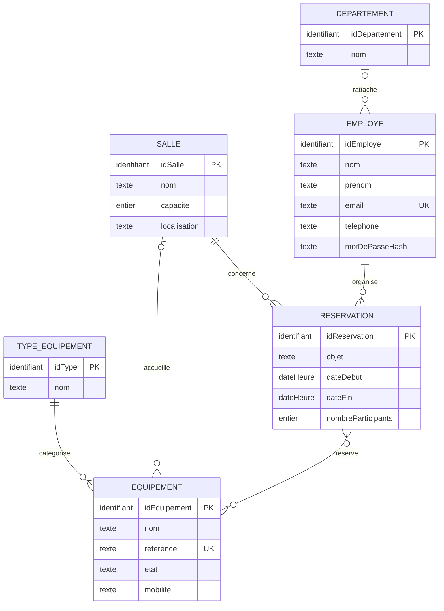

# MCD — WorkSpace Lite

## Règles essentielles

- Chaque employé a un compte. Son email unique sert d’identifiant ; le mot de passe est stocké sous forme hachée.
- Un employé peut ne pas être rattaché à un département.
- Une réservation concerne une seule salle et un seul employé. Seul le nombre de participants est enregistré pour l’instant.
- La fin d’une réservation doit être après son début. Le nombre de participants doit être positif et ne pas dépasser la capacité de la salle.
- Deux réservations d’une même salle ne peuvent pas se chevaucher ; elles peuvent se suivre sans intervalle.
- `mobilite` vaut `FIXE` ou `MOBILE`. Un équipement fixe est rattaché à sa salle et ne se réserve pas séparément. Un équipement mobile peut être associé à une réservation et ne peut pas être réservé sur des créneaux qui se chevauchent.
- Un équipement a un seul type. Sa référence est unique. En maintenance, il conserve sa salle éventuelle et ne peut pas être affecté ou réaffecté.

Les équipements réservables sont facultatifs dans une réservation. Les participants individuels ne sont pas modélisés dans cette version.
